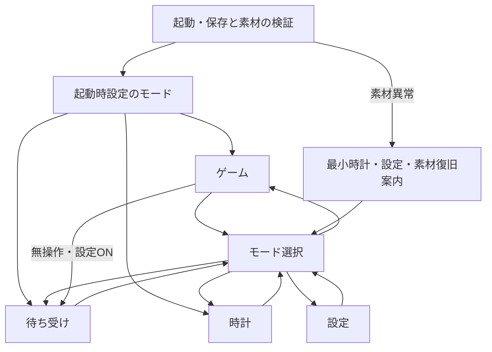
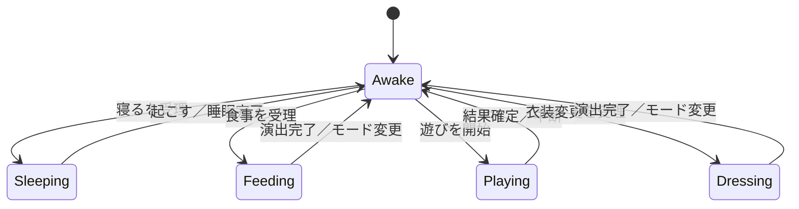
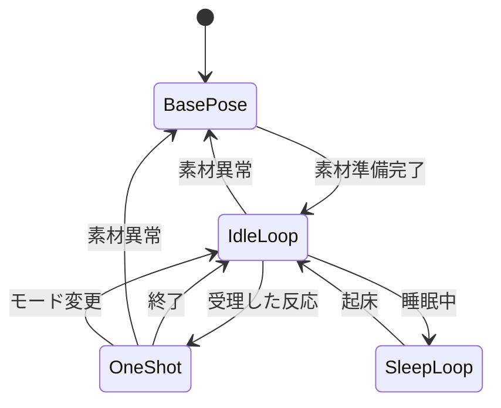

# CHIMMY育成ゲーム兼時計：暫定技術設計書

版：0.1 / 2026-10-31 / 状態：要件確認済み部分＋検証前の設計案。

根拠・仕様・比較事例は[調査報告](research.md)を参照。
本書は実装や性能保証ではない。ユーザー確定事項以外の数値・構成は提案であり、実機検証後に更新する。

## 1. 目的と設計原則

- 滑らかな輪郭のBABY CHIMMYと、着せ替え・食事・遊び・短い反応を楽しむ。
- ゲーム、待ち受け、時計を切り替えても同じ育成状態を使う。
- 時計は繁体字中国語で時刻・日付・曜日を見やすく表示する。
- オフラインでも基本動作し、SDや時刻に異常があっても復旧画面へ到達できる。
- 表示、育成、時刻、電源を分離する。ただし初版から大規模なプラグイン基盤は作らない。
- 素材・ゲーム仕様の拡張はデータ中心。新しいゲーム処理自体にはコード変更が必要な場合がある。
- コード、素材、素材の権利情報を分離し、利用許諾のない素材の公開・再配布を前提にしない。

### 1.1 主人公のキャラクター

| 項目           | 内容                                                     | 根拠・確定度                                               |
| -------------- | -------------------------------------------------------- | ---------------------------------------------------------- |
| 作品・名前     | BT21のCHIMMY                                             | ユーザー指定                                               |
| 使用する姿     | BABY CHIMMYの姿を維持する                                | 前回のユーザー確認。通常版への変更は指定されていない       |
| 誕生の背景     | BT21はLINE FRIENDSとBTSの共同プロジェクト                | [BT21公式紹介](https://www.bt21.com/about)                 |
| 制作・性格     | BTSのJIMINが制作に関わった、無邪気で情熱的な努力家の子犬 | ユーザーから共有された説明                                 |
| 公式紹介の参考 | 興味を持ったことに一生懸命で、黄色いフードが特徴         | [BT21公式キャラクター紹介](https://www.bt21.com/character) |

上記の公式ページでは、CHIMMYとJIMINの対応や子犬という記述は今回確認していない。
黄色いフードは通常のCHIMMYの紹介で確認した特徴であり、BABY版の造形や衣装ごとの見た目の細部は、適切な参考資料とその利用条件を確認して決める。

**ゲーム内の表現案**：興味のある遊びに夢中になる、食事を見てうれしそうに反応する、着替え後に短いポーズを取る。
これらは性格を参考にした本ゲーム独自の提案であり、公式の個別設定や好物として扱わない。
疲れや眠気による反応も用意し、親密度に応じて新しい表情・動作を解放する。

キャラクターの権利、参考画像・モデル等の利用条件、コードのライセンスは別々に確認する。
個人制作であっても公式素材を自由に転載・配布できるとは限らない。

## 2. 要件一覧と優先度

「必須案」は設計者の提案であり、ユーザーが数値まで承認した意味ではない。

| ID  | 要件                                          | 区分       | 確定度・検証先                         |
| --- | --------------------------------------------- | ---------- | -------------------------------------- |
| R01 | Waveshare 2.16 AMOLEDを主端末とする           | 必須       | ユーザー確定。基板版はG0で確認         |
| R02 | 非ドット絵、滑らかな輪郭、豊富な反応          | 必須       | ユーザー確定。G2で画質・性能判定       |
| R03 | ゲーム／待ち受け／時計、共通育成状態          | 必須       | ユーザー確定。G4                       |
| R04 | 食事・遊び・着せ替え・睡眠・状態確認          | 必須       | 本文に基づく初版範囲。G4               |
| R05 | BT21のBABY CHIMMYの姿を維持し、死亡・病気なし | 必須       | 追加回答で確定。G3                     |
| R06 | 親密度・反応解放で成長を表す                  | 必須       | 追加回答で確定。数式は未確定           |
| R07 | OFF中の経過反映、長期影響の上限               | 必須       | 追加回答で確定。上限値は未確定。G3     |
| R08 | UIは繁体字中国語、香港の時刻表示              | 必須       | 言語は追加回答、時刻は本文。G3/G4      |
| R09 | USB常時表示／無操作消灯を設定可能             | 必須       | 追加回答で確定。G5                     |
| R10 | 衣装状態を各モードに反映・保存                | 必須       | 表示するキャラクターに共通適用         |
| R11 | 音量、連打抑制、アニメと音の同期              | 必須案     | 数値・夜間時間帯は未確定。G2/G4        |
| R12 | SD素材、Flash内の最低限UI・復旧素材           | 必須案     | ストレージ方式はG1/G2で決定            |
| R13 | 設定・育成の保存、破損検出、更新互換性        | 必須案     | G3/G5                                  |
| R14 | NTP＋外付けRTC＋手動時刻設定                  | 必須案     | ネット未接続でも設定できる導線を推奨   |
| R15 | 衣装3、食品6、玩具2、反応8、部屋1             | 初版数量案 | 性能・制作工数で調整。確定数量ではない |
| R16 | 掃除、清潔度、図鑑、部屋変更、思い出          | 任意       | 初版必須UIとして表示しない             |
| R17 | アラーム、タイマー、季節イベント、スワイプ    | 将来       | RTC・入力・夜間設定の検証後            |
| R18 | ダイヤル、部位別衣装、OTA、LoRA               | 将来／保留 | GPIO、互換性、費用、運用を別途検討     |
| R19 | バス・交通API・接近通知                       | 対象外     | 専用コード・設定を残さない             |
| R20 | 録音・音声認識・クラウド会話                  | 対象外     | マイク搭載を理由に追加しない           |

## 3. 全体構成と開発基盤

```text
PC側
  利用権を確認した原画／モデル／録音
    -> 編集・事前レンダリング
    -> サイズ・透明度・音量の調整
    -> ローカル変換・manifest検証
    -> microSD素材パック

端末側
  App / ModeManager
    ├─ GameUI / AmbientUI / ClockUI / SettingsUI
    ├─ PetModel + Rules + ActionController
    ├─ AnimationPlayer + AudioPlayer
    ├─ AssetStore + Cache
    ├─ TimeService (単調時刻 / UTC / RTC / 同期)
    ├─ SaveStore + Settings
    └─ BoardServices (画面 / タッチ / SD / I2C / PMIC)
```

初期候補はArduino IDE 2＋C++、公式同梱LVGL 8.4系＋Arduino_GFX。
具体的なコア・ライブラリは[調査報告の互換性表](research.md#6-開発環境と互換性)を検証して固定する。
ゲームルールは可能な限りArduinoやLVGLに依存させず、PCで時刻を注入して単体テストできるようにする。
初版ではコア間固定や多数のタスクを前提にせず、負荷測定後に調整する。

## 4. 画面と操作

### 4.1 モード遷移



設定とモード選択は補助画面であり、第4の常用モードではない。
時計固定設定では自動的に待ち受けへ移動しない。
戻る操作では育成値を初期化しない。画面スタックは深さを制限する。

### 4.2 レイアウト案

| 画面     | 内容                                                                     |
| -------- | ------------------------------------------------------------------------ |
| ゲーム   | 上部に親密度・モード、中央に背景とキャラクター、下部に状態とお世話ボタン |
| 待ち受け | 部屋＋着用中キャラクター、短い自発行動、小時計は任意                     |
| 時計     | 大きな時刻、日付・曜日、モード導線。小キャラクターは性能を見て追加       |
| 設定     | 表示、音量、時刻、起動モード、情報・復旧。危険な初期化は確認付き         |

UI表記の例：`遊戲`、`待機`、`時鐘`、`餵食`、`玩耍`、`換裝`、`睡覺`、`設定`。
用語は繁体字・香港での読みやすさをユーザー確認する。

2.16インチの480pxは物理的に小さい。初期の主要タッチ領域は80×80px程度から実機で調整する。
正方形の対角2.16インチとして概算すると80pxは約6.5mmであり、余白込みの触りやすさ確認が必要。
角やケースで操作が難しい領域を避ける。文字24～32px、大時計80～100pxを比較候補にする。
全ての繁体字フォントを複数サイズで同梱せず、UI文言＋アイテム名の必要字形を生成する。

### 4.3 入力とモード変更の規則

- 初版は明示的なモードボタン。横スワイプは未採用とし、一覧スクロールとの競合を避ける。
- タッチの押下・離上・長押しを区別し、押しっぱなしから食事を連続発行しない。
- 同一アクションは実行中ボタンを無効化し、理由を短く表示する。
- モード変更時は演出を止める。既に適用した食事等の効果は取り消さない。
- 睡眠は表示演出ではなく育成状態なので、モード変更では解除しない。
- ミニゲーム途中の離脱は中断。結果確定前に報酬を付与しない。

## 5. 育成モデルと状態遷移

### 5.1 数値モデル案

満腹度、機嫌、体力、眠気を0～10000の固定小数点で保持する。
画面には5段階や0～100へ変換して表示する。親密度は別の累積値とし、初版では自然減少させない案。
清潔度は掃除の採用まで追加しない。

毎フレーム変化させず、単調時刻から得た経過時間で1秒程度ごとに更新する。
端数を保持して、更新回数の違いで結果が変わらないようにする。

```text
新しい値 = clamp(前の値 + 状態別変化率 × 経過秒 + 行動効果, 下限, 上限)
```

起きている間は空腹・眠気が進み、睡眠中は体力・眠気が回復する案。
具体的な減少率、拒否条件、睡眠時間、解放閾値はバランス表として別途承認する。
下限でも死亡・病気・データ削除・取り返しのつかない罰は発生させない。

### 5.2 育成状態と一時的な行動



永続化する基本状態はAwake/Sleeping。Feeding/Playing/Dressingは短期アクションとして扱う。
空腹・眠い等の条件は数値から導くため、状態数を全組み合わせに増やさない。
再起動では短期アクションを再実行しない。保存済みの結果だけ復元する。

食事・衣装変更の効果は受理時に一度だけ適用し、その世代の保存を要求する。
玩具の効果は短い演出型では受理時、ミニゲーム型では結果確定時に一度だけ適用する。
各イベントにaction_idを付け、重複完了通知からの二重加算を防止する。

### 5.3 アニメーション状態



優先順位案：電源終了・エラー表示 > ユーザーのお世話 > タッチ反応 > 自発行動 > 待機。
キューは短く、同種タッチ反応は1件にまとめる。際限なく予約しない。
イベント発火はフレーム番号ではなく経過msの区間判定で行い、コマ落ちでも効果音を二重発火しない。
演出用音はaction_idに結び付け、中断時に停止する。期限を過ぎた音を後から再生しない。

## 6. タスク・イベント・共有データ

初期は次の責任分担を候補とする。論理モジュールごとにタスクを増やすわけではない。

| 実行単位                 | 所有するもの                                       | 禁止すること                           |
| ------------------------ | -------------------------------------------------- | -------------------------------------- |
| App/UI（Arduino loop等） | LVGL全般、PetModel、モード、アクション             | SDの長時間読込、接続待ち、音声完了待ち |
| I/O worker               | SDファイル、素材読込、音声データ先読み、セーブ書込 | LVGL APIやPetModelの直接変更           |
| Audio worker             | I2S出力、PCMリングバッファ                         | UI操作、SDの直接オープン               |
| Time処理                 | 短い状態機械＋Wi-Fi/SNTP通知                       | UIの中で同期完了まで待つこと           |

音声と画像がI/O workerを共有する場合、短いチャンクに分割し、音声バッファ補充を優先する。
巨大画像の一括読み込みで音声を飢餓状態にしない。短い効果音は先にRAMへ置く。
SDライブラリは一つの所有者から使い、I2CはBoardServicesの共通ロックで直列化する。
I2Cロックを保持したままSD、NTP、キュー待ちをしない。

イベント例：

```text
TouchAction(action_id, kind, item_id)
AssetReady(request_id, scene_generation, handle)
AssetFailed(request_id, error_code)
AudioFinished(action_id)
SaveCompleted(save_generation)
SaveFailed(save_generation, error_code)
TimeChanged(old_utc, new_utc, quality)
PowerChanged(source, battery_valid, battery_percent)
```

UIは不変の保存スナップショットをI/O側へ渡す。
素材バッファは描画完了までUIが参照権を保持し、使用中の領域を読み込み側が上書きしない。
古い画面宛のAssetReadyはscene_generationで識別し、破棄時にバッファを解放する。
キュー満杯時は任意演出を省略し、診断カウンターへ記録する。ユーザーのお世話は勝手に成功扱いしない。
保存要求は最新世代へまとめるが、保存成功通知は実際に永続化した世代に対してのみ返す。

LVGL 8は原則スレッド安全ではないため、LVGL API呼び出しはUI所有者に限定する。
タイマーのtick通知等、公式に許される限定操作以外を別スレッド・ISRから呼ばない。
割り込みは通知だけにしてI2C通信や画面更新を実行しない。

## 7. 素材・ゲームデータ形式案

### 7.1 素材パック

PC上ではJSONで編集・検証する。起動時に必要な一覧だけ読み、固定上限の構造へ変換する。
ファイル名ではなく安定したASCIIのIDで参照し、表示名は繁体字ローカライズキーと分離する。

```text
pack/
  manifest.json
  outfits.json
  foods.json
  toys.json
  animations.json
  images/
  audio/
  licenses/
```

共通項目：`schema_version`、`pack_id`、`pack_version`、対応renderer、ファイル長、SHA-256、権利情報。
画像・音声のハッシュを描画中に毎回計算せず、パック導入検証や最初の読み込み時に確認する。

| データ    | 必須項目案                                                                 |
| --------- | -------------------------------------------------------------------------- |
| Outfit    | id、name_key、preview、base_pose、action別clip、解放条件                   |
| Food      | id、name_key、icon、prop、eat_style、満腹/機嫌効果、好みタグ、解放条件     |
| Toy       | id、name_key、icon、handler_id、clip、体力/機嫌/親密度効果、解放条件       |
| Animation | id、幅高、pixel_format、frames、frame_duration_ms、loop、events、anchor    |
| Frame     | asset_id、duration_ms。原則クリップ内でサイズと基準点を統一                |
| Event     | at_ms、type（sound/end等）、asset_id。ゲーム効果を素材イベントに持たせない |
| Room      | id、background、配置要素。初版は背景1枚でもよい                            |

食べ方はhand/plate/spoon/cup等の列挙値。handler_idはコンパイル済みの処理だけを選ぶ。
新しい食品や色違い玩具はデータ追加で済ませるが、新種のミニゲームのロジックはコードとして実装する。

### 7.2 欠損・破損時の規則

衣装の指定動作がない場合：同じ衣装の基本ポーズ＋共通エフェクトへ戻す。
別衣装へ黙って着替えたり、ID欠損をきっかけに所持情報を削除したりしない。
その衣装の基本ポーズもなければ内蔵の中立的な復旧表示と、繁体字の素材不足通知を出す。

パスのルート逸脱、未対応形式、寸法超過、0msフレーム、異常な件数、参照切れ、壊れた長さを拒否する。
初期の上限候補はmanifest 64KiB、画像最大480×480、クリップ最大120コマ。
上限はパック仕様に記録し、メモリ測定後に確定する。
SDが外れたら音を停止し、時計・設定は継続。カードの再認識は復旧操作か再起動で行う。
全クリップを起動時に読まない。キャッシュミス中は準備中表示にしてUIを止めない。

### 7.3 セーブ構造案

永続形式はエンディアン・型幅を定義したバイナリとし、C++構造体をそのまま書き込まない。
バックアップ用JSONとの変換は将来機能として分離できる。

```text
Header:
  magic, schema_version, payload_size, generation_u64, crc32
Payload:
  pet_values, rate_remainders, bond, awake_or_sleeping
  equipped_outfit_id, unlocked_ids, bounded_history
  room_id, settings
  effective_play_seconds
  time_anchor_utc_i64_or_null, time_quality
  offline_accounted_state, sleep_progress
  content_pack_id, content_pack_version
```

CRCは破損検出であり改ざん対策ではない。設定・育成の整合したスナップショットを保存する。
未知の素材IDも所持データとして残し、素材が復旧すれば再表示する。
未対応の新しいセーブ版は勝手に初期化せず、対応ファームウェアへの復旧を案内する。

## 8. 画像・音声の制作と再生

### 8.1 画像形式

制作原本：背景は高品質画像、キャラクターは透過PNG連番。
実機候補：背景RGB565、キャラクターRGB565＋8bit alphaのLVGL 8対応バイナリ。
PNGの展開負荷を避ける初期案であり、圧縮採用は測定後に判断する。

RGB565でもアンチエイリアス付きの滑らかな輪郭は作れる。色の階調不足とは別に評価する。
単色透過（クロマキー）は輪郭の中間透明度を失うため、主キャラクターには推奨しない。
LVGLの画像ABI、色深度、byte swap、ストライド、透明度の並びをconverterとrendererで一致させる。
ファイルのバイナリ構造体を直接信用せず、読み取り後に寸法・長さを検証する。

```text
原画／許諾済み3D
  -> 固定カメラ・共通ポーズ基準
  -> RGBA PNG連番
  -> 欠け・色揺れ・足元位置・ループ継ぎ目の修正
  -> 実機用サイズへ高品質縮小
  -> ローカルでRGB565+A8等に変換
  -> manifest・ハッシュ生成
  -> 実機で明暗背景に合成して輪郭を確認
```

基準点は足元等に統一し、背景と独立させる。
各フレームを違う大きさで自動トリミングする場合はオフセットを必ず保持する。
衣装は最初はセット単位でレンダリング。部位別合成は体の動きとの位置合わせ費用を見て後から導入する。
160px素材の拡大で画質を妥協せず、256px・320pxを比較して表示サイズを決める。

AIは制作補助として用い、顔・手・衣装の一貫性、透過、ループを人が確認する。
サービス採用・モデル利用権が決まるまで、そのツール専用のパイプラインを必須化しない。

### 8.2 音声

制作原本：無圧縮WAV。初期再生試験はPCM 16bit、16kHzを候補とする。
公式ES8311例が16kHz・16bit・I2S stereo設定のため、最初にその経路を確認する。
モノラルファイルを使う場合も、I2Sのスロット配置・左右複製が必要かをドライバーに合わせる。
過去案の22,050Hzは不採用確定ではなく、クロック対応と音質比較後に選べる候補。

- 初版は1音声ストリーム。反応声 > 操作音とし、同時ミキシングは必須にしない。
- 入力連打で音を無限に重ねない。短い間隔の操作音は間引く。
- 音量変更・停止時に短いフェードを入れ、ポップノイズを検証する。
- 夜間・ミュートは再生要求時に適用する。時刻未確定時の夜間判定は設定した静音方針に従う。
- アニメ開始前に必要な音を準備し、準備完了から共通の単調時計で再生する。
- 素材欠損は診断とUI通知を行い、ゲーム効果は音の成否に依存させない。

公式音声の流用・声の無断模倣を前提にせず、利用条件を確認した効果音やオリジナル録音を使う。

## 9. メモリ・帯域・ストレージ見積もり

以下はヘッダー・アラインメント・ファイルシステム管理分を除く計算値。
KiB=1024バイト、MiB=1024²バイト。

### 9.1 画像と帯域

| 寸法    | RGB565（2B/px） | RGB565＋A8（3B/px） |
| ------- | --------------: | ------------------: |
| 160×160 |           50KiB |               75KiB |
| 256×256 |          128KiB |              192KiB |
| 320×320 |          200KiB |              300KiB |
| 480×480 |          450KiB |              675KiB |

- 256×256透過30コマ：5.625MiB。
- 衣装3×動作8×30コマ：135MiB。背景・食品・音声等は別。
- 同じ条件で320×320にすると約210.94MiB。
- 16kHz・16bit・mono：32,000B/s。5秒で約156.25KiB。I2S stereo転送なら転送データ量は倍になる場合がある。
- 全画面RGB565を15fps送るだけで6.912MB/s、24fpsで11.0592MB/s（十進MB）。
- 仮にQSPI 40MHz・4bitなら理論上20MB/sだが、コマンド、転送待ち、合成、SD競合を含まない。
- 256×256透過素材を毎回SDから15fps読み出すと約2.95MB/s。小ファイルのopen/seekによる遅延にも注意。

画面のリフレッシュ、素材フレームレート、タッチ応答は別々に計測する。
全画面更新を前提にせず、キャラクターの旧領域と新領域を背景から描き直す。
SD容量が足りてもRAMや帯域が足りるとは限らない。

### 9.2 PSRAM予算案

| 用途                               |      仮予算 |
| ---------------------------------- | ----------: |
| 256×256透過の待機12コマ            |     2.25MiB |
| 別動作の3コマ先読みリング          |   0.5625MiB |
| 背景480×480 RGB565                 | 約0.4395MiB |
| 変換・合成作業領域                 |     0.75MiB |
| アイコン・必要フォントのキャッシュ |     0.75MiB |
| 素材一覧等                         |     0.25MiB |
| 計                                 |   約5.00MiB |

公称8MiBを全て使える前提にせず、残りを実行環境と余裕に残す。
30コマの大きなクリップ2本を同時に丸ごと展開する構成は避ける。
動的確保の断片化を避け、バッファプールの上限を決める。

内部RAMは別会計。480×40行×RGB565の2描画バッファで75KiB。
これにI2S DMA、タスクスタック、Wi-Fi、LVGLオブジェクト、キューが加わる。
公式Widgets例の1/4画面×2 DMAバッファは合計225KiBであり、ゲームへ無条件に継承しない。
DMA可能領域、最大連続空き領域、最低空き量を計測する。PSRAMなら何でもDMAに渡せるとはしない。

### 9.3 16MiB Flashパーティション案

実際のFlash容量確認とビルドサイズ計測前に書き込まない。OTA採否は未確定。
先頭のブートローダー・パーティションテーブル等は通常のツールチェーン配置を使う。
以下は概算配置で、まだ実際のpartition CSVではない。

**A：初版OTAなし**

| 用途                                |     開始 |               サイズ |
| ----------------------------------- | -------: | -------------------: |
| システムNVS                         | 0x009000 |    0x005000（20KiB） |
| 予約（PHY等のビルド設定に合わせる） | 0x00E000 |     0x002000（8KiB） |
| factory app                         | 0x010000 |     0x600000（6MiB） |
| ゲームNVS                           | 0x610000 |    0x010000（64KiB） |
| LittleFS復旧用素材等                | 0x620000 | 0x9E0000（9.875MiB） |

**B：OTA用の2スロットを確保**

| 用途                 |     開始 |               サイズ |
| -------------------- | -------: | -------------------: |
| システムNVS          | 0x009000 |    0x005000（20KiB） |
| otadata              | 0x00E000 |     0x002000（8KiB） |
| ota_0                | 0x010000 |     0x400000（4MiB） |
| ota_1                | 0x410000 |     0x400000（4MiB） |
| ゲームNVS            | 0x810000 |    0x010000（64KiB） |
| LittleFS復旧用素材等 | 0x820000 | 0x7E0000（7.875MiB） |

両案とも末尾は0x1000000。Bはスロットを持つだけでは安全なOTAにならない。
採用時は更新認証、完全性、起動確認、ロールバック、素材・セーブ互換性を追加設計する。
復旧用の最低限フォント・文字UIはアプリ内にも保持し、LittleFSが壊れても設定へ入れるようにする。
パーティション変更はセーブを失う可能性があるため、バックアップと復元を伴う移行作業とする。

## 10. 時刻・RTC・OFF中の育成

### 10.1 二種類の時計

| 時計         | 用途                                     |
| ------------ | ---------------------------------------- |
| 単調経過時間 | 起動中の育成・音声・アニメ・タイムアウト |
| UTC日時      | 時計表示、日付、RTC、OFF中の経過推定     |

起動中は64bitの`esp_timer_get_time()`等を利用する。深いスリープ・再起動をまたぐ連続性は別途処理する。
時刻同期で壁時計が進んだり戻ったりしても、起動中の育成時間を増減させない。
秒数をUnix時刻の差で毎フレーム計算しない。

外付けRTCとセーブの日時はUTCに統一し、表示時だけ香港のUTC+8へ変換する案。
POSIX TZを使う場合の表現は例として`HKT-8`。符号の向きをテストする。
設定上の地域名は`Asia/Hong_Kong`としても、組み込み環境にIANA tzdbがあるとは仮定しない。
12/24時間は選択案、初期値は未確定。

### 10.2 時刻の品質と同期

品質は`UNKNOWN / RTC_VALID / USER_SET / NETWORK_SYNCED`を区別し、最終同期日時も持つ。
RTCの読取成功だけで有効にせず、停止フラグ、値の範囲、保存された日時との関係を検査する。

起動時はRTCを確認し、利用可能なら表示を始める。
Wi-Fi設定済みなら同期を試み、例として15秒で初回待ちを切り上げる。
以後はバックオフし、常時スキャンしない。同期後はWi-Fiを止める案。
接続失敗を時刻成功と扱わず、最終有効時刻から時計を進めて未同期表示にする。
時刻自体が不明なら`--:--`と`請設定時間`を表示する。

手動設定はネット接続不能時のために推奨。Wi-Fi設定方法（タッチ入力／一時AP／USB）は別途決定する。
SSID・パスワードをコードやログ、素材パックに入れない。一時APを採用するなら明示操作で開始し、自動終了を設ける。
ネットワーク時刻は完全に信頼できる入力ではない。大きな補正は品質を見直し、育成へ無制限に反映しない。

### 10.3 OFF中の経過処理

ユーザー確定：OFF中も反映し、長期放置の影響に上限を設ける。
**提案：初期比較値として影響時間の上限12時間。値は未承認。**
親密度はOFF中に減らさず、負の影響を伴う値は下限で止める。
睡眠中だった場合の回復を反映し、OFF中に新しい食事・遊び・報酬イベントは生成しない。

```text
前回保存時刻と復帰時刻が比較可能:
  raw_elapsed = 復帰時UTC - 保存時UTC
  raw_elapsed < 0 -> 補正異常として通知、負の進行は適用しない
  raw_elapsed >= 0 -> 適用時間 = min(raw_elapsed, 承認済み上限)
時刻が比較不能:
  前回状態を保ち、OFF期間の処理を保留したことを明示
```

上限を適用したときは`離線期間已按上限計算`等の案内を出す。
上限を超えた残り時間を次回起動へ繰り越さない。
睡眠完了などの境界が途中にある場合は区間を分けて計算し、1秒ずつ何年分もループしない。

重要な整合性：

1. 復帰時に計算した状態と「この復帰時刻まで精算済み」のアンカーを一緒に保存する。
2. 保存成功前は次の報酬を伴う操作を確定しない。再起動時は旧スナップショットから同じ結果を再計算できる。
3. 起動中にNTP・手動修正した場合は、その時点までの育成を単調時間で確定し、新UTCアンカーで保存する。
4. 時刻不明で起動し後から同期した場合、起動後の単調経過分をOFF時間として再加算しない。
5. その推定には起動時からの経過を差し引く。再構成できない複数の不明時刻セッションは勝手に推定せず、保留期間の扱いをユーザーへ案内する。

不明時刻セッションをまたぐ場合の推奨初期方針は「不明期間は進行させず、現在の状態から再開」。
これは例外時の提案であり、通常のOFF中進行を無効にするものではない。最終承認が必要。

## 11. セーブ・復旧

初期案はNVSの2キーに世代番号付きの完全なスナップショットを交互に保存する。
ゲーム専用NVSへ、例として`save_a`、`save_b`の2 blobを持つ。
各blobを4KiB程度以内に抑え、巨大な履歴や画像をNVSに保存しない。

1. 最新状態をスナップショット化する。
2. 古い側へ、サイズ・schema・generation・CRC付きで書く。
3. 書込結果とcommit、再読込の整合を確認する。
4. その世代の保存成功をUIへ通知する。
5. 起動時は両方を検証し、有効なうち新しい世代を採用する。

複数キーを別々に更新するだけでは状態全体のトランザクションにならない。
NVSの耐電源断機構があっても、書込中の最新データを必ず保持できるわけではない。
旧世代への復旧は表示・ログで通知する。
両方壊れていれば消去をせず、復元／初期化確認画面へ移る。

保存タイミング案：

- 通常の時間進行：dirty状態を60秒間隔でまとめる。
- 食事・衣装・解放・設定変更：短い遅延でまとめるが、「保存済み」は完了通知後。
- 正常終了・低電池：最新スナップショットを優先保存する。
- 毎フレーム、音声イベントごと、時計の秒表示ごとには保存しない。

突然の電源断では最後の成功保存後の変化が失われ得る。
OFF中計算による時間の補完と、未保存アクションの喪失を区別して説明する。
電源断直前に必ず保存できるとは保証しない。

ファームウェア更新は対応schemaを判定し、旧データを残して新世代へ移行する。
バックアップは任意機能案。採用時はschema・CRC・サイズ検証後に候補スロットへ復元し、確認前に既存世代を消さない。
素材の入れ替えと育成セーブは分離し、SDを交換しても所持アイテムを初期化しない。

## 12. 電源・明るさ・長時間表示

画面モード、育成の睡眠、端末の電源状態を独立させる。

| 電源状態   | 画面             | 育成処理                          |
| ---------- | ---------------- | --------------------------------- |
| Active     | 通常表示         | 起動中の単調経過で進行            |
| Dim        | 減光、演出低頻度 | 同じく進行                        |
| DisplayOff | 消灯、MCU動作    | 同じく進行。描画・任意音を停止    |
| LightSleep | 原則消灯         | 復帰時の経過補完。導入は後段      |
| DeepSleep  | 消灯、再起動復帰 | 保存＋復帰時計算。導入は後段      |
| PMIC Off   | 本体電源OFF要求  | RTC保持を確認し、次回起動時に計算 |

USB用と電池用で、明るさ、無操作減光、無操作消灯、消灯後の本体OFFを分ける。
USB常時表示を選んだ場合も、手動消灯と減光設定は使えるようにする。
具体的な秒数・夜間時間帯・電池時の自動OFFは未確定。

表示ON/OFFはCO5300の対応コマンドを使用する。表示消灯だけではMCUやPMICは停止しない。
タッチ復帰はタッチ側の給電・割り込みが残っている状態でのみ可能。
DeepSleep・PMIC Offからの復帰を通常タッチと同一視しない。PWRによる復帰を先に検証する。
復帰に使った最初のタッチをそのまま「食事」等の操作へ渡さない。

AMOLED対策：

- 暗い背景、適度な明るさ、非操作時の演出頻度低下。
- 時計の数字やアイコンを表示領域内で少しずらす。
- 固定の高輝度枠や白い大面積を避ける。
- 長時間表示時の残像・画質を観察する。

ピクセルシフトや黒背景だけで焼き付きを防げるとは保証しない。
24～72時間試験も長期寿命を証明するものではない。

電池残量は有効フラグ付きで扱い、低下判定には連続確認・ヒステリシスを設ける。
低電池時は音・Wi-Fi・高輝度演出を止め、保存を先に行う。
保存失敗を記録・表示し、安全な電源終了を無期限に待たせない。
電池の保護回路とPMIC保護をソフトウェア残量判定の代用にしない。
充電中の温度、電源状態ごとの電流は実測し、電池仕様と照合する。

## 13. 段階的開発計画・合格ゲート

書き込み開始は別途許可と現行スケッチ・設定の保全後。今回は未実施。
基礎試験には権利確認済み素材か独自の中立的な仮素材を使う。

| ゲート                | 実装・検証内容                                        | 合格基準案                                                                    |
| --------------------- | ----------------------------------------------------- | ----------------------------------------------------------------------------- |
| G0 環境保全           | 基板版、電池・SD仕様、IDE設定、現行スケッチ、復旧手順 | 出所と手順が記録され、再ビルド・復旧方法が明確                                |
| G1 周辺機器           | 画面、タッチ、PMIC、SD、音声、RTCを個別確認           | 画面方向とタッチ一致、既知ファイル読取一致、発音確認、RTC時刻往復、異常を明示 |
| G2 同時性能           | 背景＋透過クリップ＋短い音＋SD先読み                  | 下記性能試験に合格。素材サイズ・fps・形式・バッファ数を確定                   |
| G3 時計・保存・育成核 | UTC/RTC、単調時間、OFF補完、2世代保存、状態モデル     | 時刻補正で二重進行なし、再起動で重複報酬なし、旧世代から復旧                  |
| G4 3モード・お世話    | 3モード、食事、玩具、衣装、繁体字UI                   | 状態・衣装共有、連打抑制、睡眠維持、主要操作の文字欠けなし                    |
| G5 運用・異常         | SD異常、同期失敗、電源断、電池、長時間表示            | 復旧UIへ到達、保存済み状態が再現、ハング・再起動・リークなし                  |
| G6 コンテンツ拡張     | 素材量と反応を増やす                                  | パック検証成功、予算内、ユーザーの画質・かわいさ評価に合格                    |

### 13.1 性能試験の具体案

- 256×256と320×320の透過キャラクターを、480×480背景の上で再生する。
- 15fpsを初期最低目標、24fpsを改善目標とする。これは現時点の保証値ではない。
- 各条件10分、素材SD読込あり、16kHz音声あり、タッチ入力ありで計測する。
- 最低目標：実効平均15fps以上、フレーム間隔p95が80ms以下、200msを超える停止なし。
- 操作から視覚フィードバックまでp95が100ms以下、モード切替p95が300ms以下。
- 音声アンダーラン0回、アニメと効果音の開始差p95が50ms以下。
- Wi-Fi同期と保存の追加負荷も別条件で計測する。
- 最小空き内部RAM、DMA領域の最大連続空き、PSRAMピーク、キュー最大長を記録する。
- UIによる主観評価：輪郭のギザギザ、透過縁、顔の揺れ、ループの継ぎ目、文字の可読性。

不足時は、全画面更新削減 → 素材先読み → バッファ・SDモード調整 → 圧縮形式比較の順で検討する。
画質・サイズ・fpsを変える必要があれば結果を示して合意し、勝手にドット絵へ変更しない。

### 13.2 状態・時刻・障害の試験ケース

| ケース                                    | 期待結果                                                 |
| ----------------------------------------- | -------------------------------------------------------- |
| 3モードを100回切替                        | 育成・衣装保持、古い素材完了通知で画面が変わらない       |
| 食事ボタンを連打                          | 1操作分のみ加算、音や演出キューが増え続けない            |
| 睡眠中に時計へ移動                        | 睡眠が継続                                               |
| NTPで前後1時間補正                        | 起動中の育成進行量が変わらない                           |
| OFF期間0、1時間、上限直前、上限直後、30日 | 指定上限と状態境界が正確、残期間の繰り越しなし           |
| RTC無効で起動後に同期                     | 起動後の経過を二重加算しない                             |
| 日付境界、月末、うるう日、12/24時間       | 香港表示の日時・曜日が正しい                             |
| 書込前／途中／commit後に電源断            | 有効な旧世代または新世代から復旧。途中データを採用しない |
| 一方のセーブ破損、両方破損                | 旧世代復旧通知、または非破壊の復旧画面                   |
| SDなし、画像破損、音欠損、未対応パック    | 最小UI維持、原因通知、育成データを消去しない             |
| 設定した上限を超える素材                  | 先に検証で拒否し、巨大メモリ確保を試みない               |
| Wi-Fi不通                                 | 起動やUIが接続待ちで停止しない                           |
| USBと電池の切替、画面消灯、PMIC OFF       | 状態を混同せず、保存・復帰を検証                         |
| 24時間、続いて72時間運用                  | 予期しない再起動・ハング・継続的な空きメモリ減少なし     |

故障注入はテストデータ・保全済み機体で行い、日常用SDや唯一のセーブを無断で破損させない。
電源試験はコネクター・電池の安全条件を確認して実施する。
電池ランタイムの合格時間は容量・目標が決まってから追加する。

## 14. 残る設計判断

実装へ進む前に、次を優先して確定する。

1. **電池・SD・ケース**：電池の型番・容量・仕様、SD容量とFAT形式、ケースの有無、基板リビジョン。
2. **育成バランス**：OFF影響上限（候補12時間）、睡眠の終了条件、満腹時の拒否・好み、解放条件。
3. **時刻喪失時**：不明なOFF期間は進行させず再開する提案の可否。
4. **表示・音**：起動モード、12/24時間、USB/電池別タイムアウト、夜間時間帯・明るさ・ミュート。
5. **素材制作**：利用権を確保できる原画／モデル、AI利用サービス・予算、2Dか事前レンダリングか。
6. **初版数量**：衣装3・食品6・玩具2・反応8の範囲、ボールとしゃぼん玉のどちらを先に作るか。
7. **運用**：Wi-Fi設定方法、USB更新のみかOTAも必要か、セーブのバックアップ・復元を初版に含めるか。
8. **書き込み許可**：現行環境を保全した上で、どの検証スケッチから試すか。

現段階ではG2の同時再生性能とG3のRTC・電源断処理が、設計確定の最大の関門である。
それらを測定する前に最終fps、駆動時間、全衣装の素材形式を確定しない。
